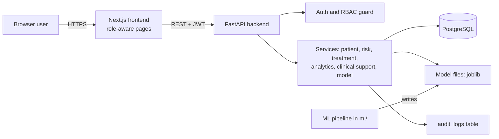
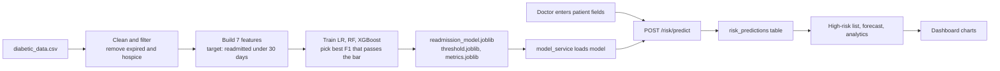

# Architecture

## System shape

```
Browser (Next.js, Render)
   |  HTTPS + JWT
FastAPI backend (Render, Docker)
   |-- RBAC guard on every protected endpoint
   |-- services: auth, patient, risk, treatment, analytics, clinical support, model
   |-- SQLAlchemy ORM ----> Render PostgreSQL
   |-- joblib model files (readmission_model, threshold, metrics)

ML pipeline (ml/): load -> preprocess -> features -> train -> evaluate -> artifacts
```

## Components

| Component | Technology | Folder |
|---|---|---|
| Frontend | Next.js 15, TypeScript, Tailwind, Recharts | `frontend/` |
| Backend | FastAPI, SQLAlchemy, Pydantic, python-jose, passlib/bcrypt | `backend/` |
| Database | PostgreSQL (Render); SQLite for local development | `database/` |
| ML | pandas, scikit-learn, XGBoost, joblib | `ml/` |
| Hosting | Docker on Render | `frontend/Dockerfile`, `backend/Dockerfile` |
| CI | GitHub Actions | `.github/workflows/ci.yml` |

The backend layers are: endpoint (HTTP and permission check) -> service (business
logic) -> model (database tables). Endpoints contain no business logic.

## Request path: risk prediction

1. The doctor submits the form; the frontend calls `POST /api/v1/risk/predict` with a bearer token.
2. The permission dependency checks the role. No token gives 401; a role without the permission gives 403.
3. `risk_service.score_and_save` checks the patient exists (404 if not).
4. `model_service.predict_readmission` scores the seven input fields with the loaded model.
5. `categorise_risk` bands the probability into low, medium or high using configured thresholds.
6. The result is saved in `risk_predictions` and the action is written to `audit_logs`.

## Data flow for a researcher

Researchers never receive patient identifiers. `get_anonymised_cohort` returns a
pseudo ID (`RSCH-0001`), demographics, and the latest risk category only. It omits
patient ID, MRN and assigned doctor.

## Component diagram



| Component | Responsibility |
|---|---|
| Frontend | Login, role-aware navigation, forms, charts |
| Auth and RBAC guard | Verifies the JWT and checks the permission on every protected endpoint |
| Services | Business logic; apply doctor scoping and researcher anonymisation |
| PostgreSQL | Users, patients, admissions, predictions, treatments, audit logs |
| Model files | Trained model, threshold and metrics, loaded by the backend |
| ML pipeline | Cleans data, trains, evaluates and writes the model files |

## Data flow: raw dataset to dashboard



## Where authentication, authorisation and audit sit

| Concern | Where | How |
|---|---|---|
| Authentication | `auth_service`, `/auth/login` | Password checked with bcrypt; a JWT is issued; login attempts are audited |
| Authorisation | `require_permission(...)` dependency on each endpoint | 401 if no valid token, 403 if the role lacks the permission |
| Data scoping | Services | Doctors see only assigned patients; researchers get anonymised rows |
| Audit logging | Services and endpoints | Logins, user changes and predictions write to `audit_logs` |

## Why PostgreSQL only (the planned PostgreSQL and MongoDB split)

The original design used MongoDB for clinical notes, model runs and prediction events.
Only PostgreSQL was built. Every feature (users, patients, predictions, treatments,
analytics, audit) is relational and needs joins and constraints, which Postgres
provides. Model runs are read from model files, and prediction events live in
`risk_predictions`. A second database would have added hosting cost and code with no
feature that needed it. This is a deviation from the brief and is listed in Known gaps.

## Design decisions

| Decision | Reason |
|---|---|
| Database-agnostic ORM | Same code runs on SQLite locally and Postgres in production |
| 7-feature model | The data-entry form can only collect seven fields |
| Threshold chosen for best F1 with recall >= 0.50 | Missing a readmission costs more than a false alarm |
| Soft delete for users | Keeps the audit trail intact |
| Config from environment | No secrets or paths are hardcoded |

## Differences from the original design

MongoDB appeared in the first architecture diagram. It was not built; the model
registry reads files from disk. See Known gaps in the milestone 4 report.