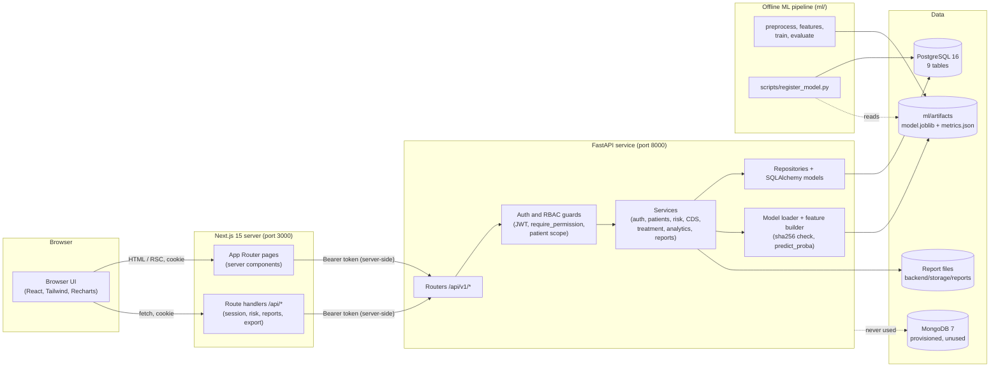
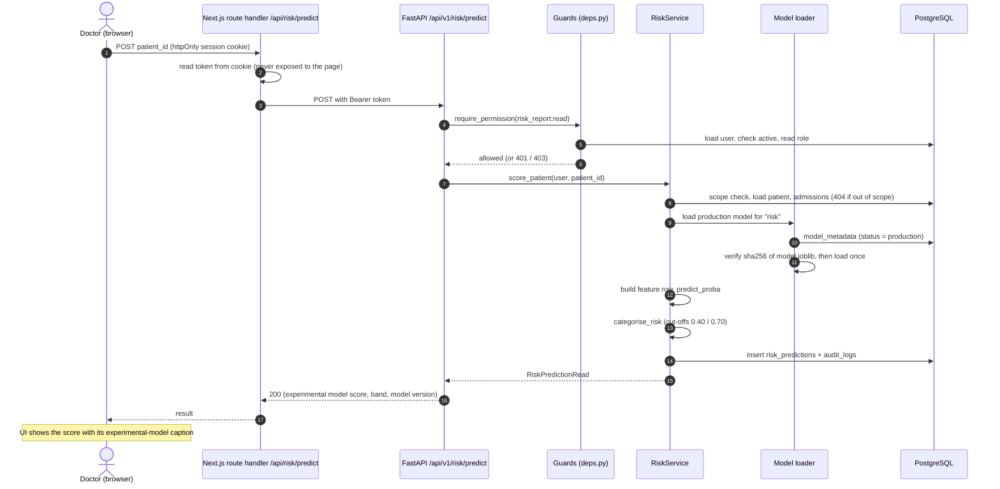
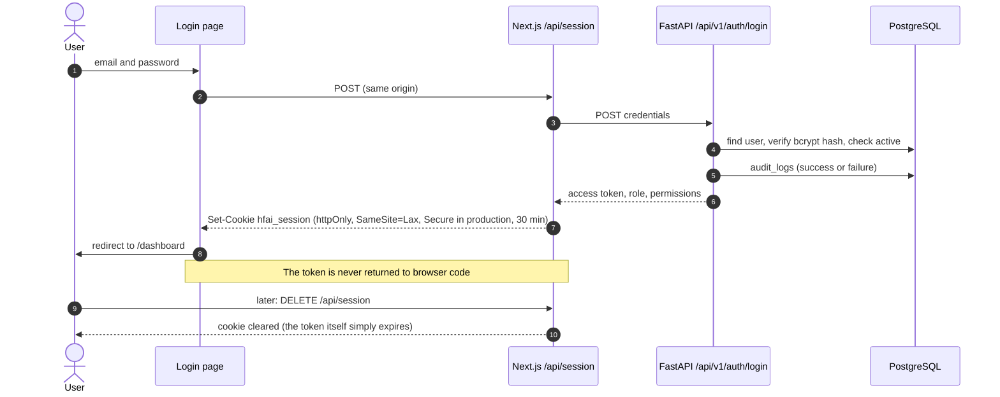
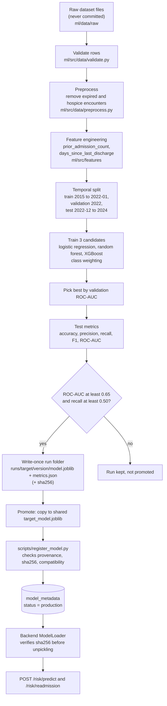
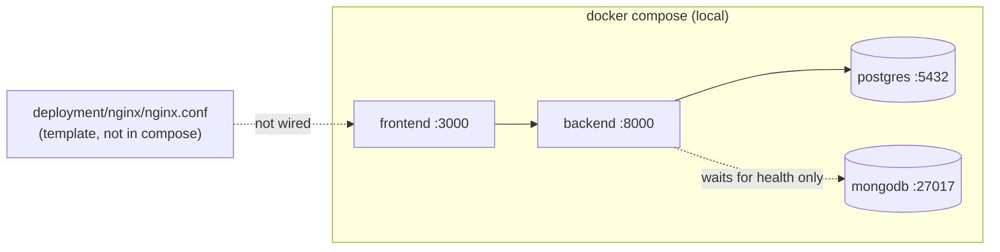

# Architecture

HealthForecast AI is a three-tier web application with a separate offline
machine-learning pipeline. This document describes what the repository
contains today. Planned or abandoned designs are called out as such, and the
original design documents in [`docs/niyati/`](../niyati/) are kept unchanged as
history.

> **Status of the models.** Predictions come from experimental logistic
> regression models trained on a public research dataset. They have not been
> clinically validated, and their scores are rankings, not calibrated
> probabilities. Every diagram below that shows a prediction should be read
> with that in mind.

## 1. Components

| Layer | Technology | Source |
|---|---|---|
| Frontend | Next.js 15.5 (App Router), React 19, TypeScript, Tailwind CSS 3, Recharts 3 | `frontend/package.json` |
| Backend | Python 3.11, FastAPI, SQLAlchemy 2, Alembic, Pydantic 2, JWT (`python-jose`), bcrypt, `openpyxl` and `fpdf2` for reports | `backend/requirements.txt` |
| Database | PostgreSQL 16 | `docker-compose.yml` |
| ML | scikit-learn, XGBoost, pandas, NumPy, joblib. TensorFlow is listed in `ml/requirements.txt` but no code uses it | `ml/requirements.txt`, `ml/src/` |
| Delivery | Docker, Docker Compose, GitHub Actions | `docker-compose.yml`, `.github/workflows/` |

The frontend never holds data of its own. Every page is a server component that
fetches from the backend with the signed-in user's token, so access decisions
are always made by the backend.

## 2. Roles and the experience each gets

Four roles share one application. The navigation is built from the permission
list the backend returns (`/auth/me`), then sorted into three groups:
**Records** (Overview, Patients), **Insights** (Analytics, Treatment, Research,
Reports) and **Administration** (Users). A group is hidden when it would be
empty. This is presentation only; every route is authorised again by the
server (see [`docs/04-rbac`](../04-rbac/README.md)).

| Role | Reaches |
|---|---|
| System Administrator | All areas, including Users |
| Doctor | Overview, Patients (own patients), Treatment (own patients) |
| Hospital Administrator | Overview, Patients (read only), Analytics, Treatment, Reports |
| Researcher | Overview, Patients (anonymised cohort), Analytics, Treatment, Research, Reports |

## 3. Request path: a risk prediction

If no verified model is registered, the endpoint answers `503`; if the patient
lacks required data, `422` lists the missing fields.

## 4. Authentication and session

- Passwords are hashed with bcrypt; an unknown email and a wrong password give
  the same `401`.
- Every backend request re-reads the account, so a deactivated user or a
  changed role takes effect on the next request.
- There are no refresh tokens, password reset or lockout (documented in
  [`docs/03-api`](../03-api/README.md#not-implemented)).
- A page calls `requireUser()`, which asks `/auth/me`; no valid session
  redirects to `/login`. There is no Next.js middleware.

## 5. Machine-learning pipeline

Two models are trained by the same code: `risk` (outcome: in-hospital death or
30-day readmission) and `readmission` (30-day readmission after a live
discharge). The decision threshold used for the reported metrics is a fixed
0.5. Calibration is switched off (`calibration.method: none`), and class
weighting inflates the stated values, which is why scores must not be read as
probabilities. Model files are never committed and are not present in the
Docker images. Results and limitations are in
[`docs/06-milestones/milestone-2.md`](../06-milestones/milestone-2.md).

## 6. Reporting, research and audit

- **Reports.** `ReportService` takes figures from the same `AnalyticsService`
  and `TreatmentService` methods the dashboards use, renders CSV, XLSX or PDF,
  writes the file to `REPORT_STORAGE_DIR` (default `backend/storage/reports`,
  not committed) and records metadata in `reports`. Files older than
  `REPORT_RETENTION_DAYS` (default 30) are removed by the purge route.
- **Research.** The anonymised cohort and export routes use salted
  pseudonymous ids, generalised age bands and a minimum cohort size (default
  10), and are audit-logged with their filters.
- **Audit logging.** `audit_logs` is append only and records authentication
  attempts, patient reads and listings, predictions, research exports,
  analytics reads and administrative changes. Nothing reads it back yet: there
  is no audit viewer or export (documented gap, SRS `FR-AUD-04`).

## 7. Deployment topology

What exists: `docker-compose.yml` (PostgreSQL, MongoDB, backend, frontend with
health checks on the data services), two Dockerfiles, and an nginx
configuration template that is not part of the compose file. What has not
been verified or does not exist: a full `docker compose up` from a clean state
with sign-in and a prediction, a cloud deployment, TLS, and a production
secret store. See [`docs/08-deployment`](../08-deployment/README.md) for the
runbook and the open risks.

## 8. Design decisions and open questions

| Topic | Position | Status |
|---|---|---|
| Operational database | PostgreSQL only in practice | The brief also lists MongoDB; the project's Database Design excludes it; no recorded decision |
| Dataset | The models were trained on the India Hospital Readmission export | The brief names Diabetes 130-US; no recorded ratification |
| Models | Logistic regression won on validation ROC-AUC against random forest and XGBoost | The ML Design planned XGBoost as primary; this is a result, not a plan |
| Browser never holds the token | httpOnly cookie plus server-side proxy | Implemented and tested |
| Authorisation | Server side only; frontend hides links for convenience | Implemented |
| Clinical decision support | Fixed rules on the stored score; no language model | Implemented |
| Original wireframes | Not produced at Milestone 1 | Current-state wireframes added later, see [`docs/05-wireframes`](../05-wireframes/README.md) |
