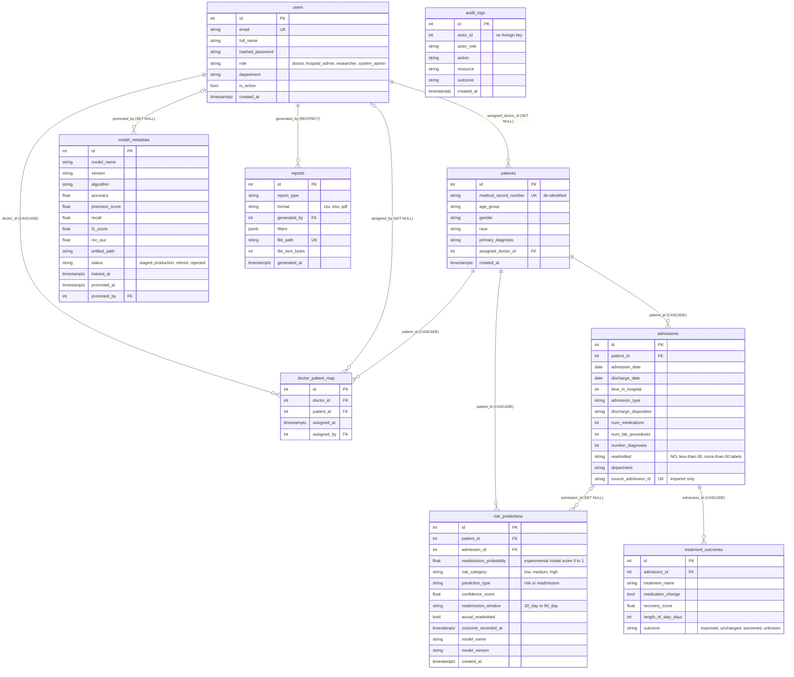

# Database design

PostgreSQL 16 is the operational database. It holds every table the application
reads or writes. MongoDB is provisioned in `docker-compose.yml` but nothing in
the application uses it (section 8).

Sources of truth, in the order to trust them:

1. [`backend/app/models/`](../../backend/app/models/) (SQLAlchemy models) and
   [`backend/alembic/versions/`](../../backend/alembic/versions/) (migrations
   `0001` to `0005`). `backend/tests/test_database_schema.py` checks that the
   migrations and the models produce the same tables.
2. [`database/postgres/schema/01_schema.sql`](../../database/postgres/schema/01_schema.sql),
   a reference script mounted by Docker Compose for a fresh volume. It is
   currently in the same shape as migration head `0005`, but no automated test
   compares it with the models (section 6).

## 1. Entity-relationship diagram

Nine tables, verified against `01_schema.sql`, the models and the migration
chain. A development database that is running now contains exactly these nine
tables plus `alembic_version`, at revision `0005`.



`audit_logs.actor_id` is deliberately not a foreign key, so deleting a user
never rewrites the audit trail. The table is append only: the repository
exposes no update or delete.

## 2. Tables, constraints and indexes

| Table | Purpose | Key constraints | Indexes |
|---|---|---|---|
| `users` | Platform accounts | `email` unique; `users_role_check` limits `role` to the four roles | `idx_users_role` |
| `patients` | De-identified patient record (medical record number only; no names, addresses, phone numbers or dates of birth) | `medical_record_number` unique; `assigned_doctor_id` references `users` (SET NULL) | `idx_patients_assigned_doctor` |
| `doctor_patient_map` | Lets several doctors co-manage a patient | `uq_doctor_patient (doctor_id, patient_id)`; cascade on delete of either side | `idx_dpm_doctor`, `idx_dpm_patient` |
| `admissions` | One admission or discharge episode | `admissions_date_order_check` (discharge on or after admission); cascade from `patients` | `idx_admissions_patient`, `idx_admissions_department`, unique `uq_admissions_source_admission_id` |
| `risk_predictions` | Every stored risk score and readmission forecast (append only) | Range checks on score and confidence (0 to 1); `risk_category` in low/medium/high; `prediction_type` in risk/readmission; `readmission_window` in 30_day/90_day; a readmission forecast must carry an `admission_id` | `idx_risk_patient_created (patient_id, created_at DESC)`, `idx_risk_predictions_type` |
| `model_metadata` | Registry of trained model versions and their metrics | `uq_model_metadata_name_version`; `algorithm` in xgboost/random_forest/logistic_regression; `status` in staged/production/retired/rejected; metric range checks | `idx_model_metadata_status (model_name, status)` |
| `treatment_outcomes` | Treatment or medication outcomes per admission | `outcome` in improved/unchanged/worsened/unknown; cascade from `admissions` | `idx_treatment_admission` |
| `reports` | Metadata for generated exports (the file lives on disk) | `report_type` and `format` checks; `file_size_bytes >= 0`; `file_path` unique; `generated_by` RESTRICT | `idx_reports_generated_by (generated_by, generated_at DESC)` |
| `audit_logs` | Append-only trail of authentication, patient access, predictions, exports and administrative changes | none (no foreign key by design) | `idx_audit_actor_created` |

The score column keeps its historical name, `readmission_probability`. It
stores an **experimental model score**, not a calibrated probability (see
[`docs/03-api`](../03-api/README.md#clinical-safety-semantics-of-the-prediction-endpoints)).
`risk_category` is derived from fixed 0.40 and 0.70 cut-offs by the backend.

## 3. Migrations

Alembic owns the real schema. The chain is linear and the head is `0005`.

| Revision | Date | Change |
|---|---|---|
| `0001` | 2026-08-30 | Initial schema: `users`, `patients`, `doctor_patient_map`, `admissions`, `risk_predictions`, `treatment_outcomes`, `audit_logs` |
| `0002` | 2026-09-23 | `model_metadata` registry; extends `risk_predictions` with type, confidence, window and outcome columns and their constraints |
| `0003` | 2026-09-27 | `admissions.department`; constraint on `treatment_outcomes.outcome` |
| `0004` | 2026-09-27 | `reports` table |
| `0005` | 2026-10-09 | `admissions.source_admission_id` with a unique index, for exact and repeatable dataset imports |

Revision order and the head were verified by reading the files. The state of a
running development database was read without changing it: it holds the nine
tables and `alembic_version = 0005`. How that database first reached `0005`
(Alembic, or the SQL script plus a stamp) is not recorded in the repository.

## 4. Doctor scoping in a query

A doctor must only reach their own patients. The rule is written once, in
`PatientRepository.scope_clause`
([`backend/app/repositories/patient_repository.py`](../../backend/app/repositories/patient_repository.py)):

```python
mapped = exists().where(
    DoctorPatientMap.patient_id == Patient.id,
    DoctorPatientMap.doctor_id == doctor_id,
)
return or_(Patient.assigned_doctor_id == doctor_id, mapped)
```

A patient is in scope when the doctor is the primary assignment or is linked
through `doctor_patient_map`. `EXISTS` is used instead of a join so that a
patient who is both primary and mapped appears once. `doctor_id` comes from the
authenticated caller through `patient_scope_for`, never from a request
parameter. Analytics, risk, treatment, report and decision-support services
reuse the same function.

## 5. Dataset mapping and provenance

Two import profiles load different public research datasets into the same
`patients` and `admissions` tables
([`backend/app/services/dataset_import_service.py`](../../backend/app/services/dataset_import_service.py),
run with [`scripts/import_dataset.py`](../../scripts/import_dataset.py)). Neither
dataset is committed to the repository (see
[`ml/data/README.md`](../../ml/data/README.md)).

**India Hospital Readmission (2015 to 2024), the primary dataset in the ML
configuration.** A relational export joined on its own keys.

| Source file and column | Target |
|---|---|
| `patients.patient_id` | `patients.medical_record_number` |
| `patients.age` | `patients.age_group`, stored as the age value in text; banding into age groups happens only in the research outputs |
| `patients.gender` | `patients.gender` |
| `admissions.admission_id` | `admissions.source_admission_id` |
| `admissions.admit_date`, `discharge_date` | `admissions.admission_date`, `discharge_date` |
| `admissions.los_days` | `admissions.time_in_hospital` |
| `admissions.admit_type`, `discharge_type` | `admissions.admission_type`, `discharge_disposition` |
| `admissions.readmitted_30d` | `admissions.readmitted` (`<30` or `NO`) |
| `diagnoses.diag_desc` (rank 1, of the patient's most recent admission) | `patients.primary_diagnosis` |

Not imported, because the schema has no column for them: patient `state`,
`bpl_card`, `insurance_type`, `comorbidity_count`, `prev_admissions`; admission
`ward_type`, `hospital_id`, `num_procedures`, `charlson_index` and lab values;
and the billing and hospital tables. `admissions.department` stays empty for
this export, because it has no department field.

**Diabetes 130-US (1999 to 2008), named in the project brief.** One CSV:
`patient_nbr` becomes the medical record number; `age`, `gender`, `race` and
`diag_1` fill the patient; `time_in_hospital`, `admission_type_id`,
`discharge_disposition_id`, `num_medications`, `num_lab_procedures`,
`number_diagnoses` and `readmitted` fill the admission.

Validation follows the SRS: discharge cannot precede admission, ages and stays
must be plausible, duplicate encounters are collapsed, and rejected rows are
counted against a named reason instead of being dropped silently. Every run is
one transaction; `--dry-run` validates and rolls back. Repeating the India
import is idempotent through `source_admission_id`.

**Data categories to keep apart**

| Category | What it is | Where it appears |
|---|---|---|
| Public research data | The imported dataset rows (patients and admissions). The India export is a public Kaggle dataset; whether any of it is synthetic is not established in the repository. | `patients`, `admissions` |
| Model output | Experimental scores | `risk_predictions` |
| Other loaded data | **Neither importer creates `treatment_outcomes` rows or admission departments for the India export.** A database holding them was filled by other means, such as API-seeded synthetic test data, and those values are not real clinical outcomes. [Inferred from the importer code; not recorded in the schema.] | `treatment_outcomes`, `admissions.department` |
| QA accounts | Local test users created through the API for testing | `users` |

A development database in use for this project contains 2,036 patients, 3,746
admissions, 129 treatment outcomes, 174 stored predictions and 4 model versions
(counts read at the time of writing; they are not part of the schema and will
differ elsewhere).

## 6. Setting up a database, and the SQL-versus-Alembic conflict

There are two ways a PostgreSQL database receives its schema, and they must not
be mixed on one database.

| Path | How | Use when |
|---|---|---|
| Alembic (recommended) | Create an empty database, then `cd backend && alembic upgrade head` | Local development and the documented import flow (`scripts/import_dataset.py` and `scripts/register_model.py` both start with `alembic upgrade head`) |
| SQL init script | `docker-compose.yml` mounts `database/postgres/schema/` into `/docker-entrypoint-initdb.d`, so a **new** volume is initialised from `01_schema.sql` | A first `docker compose up` on a clean volume |

**Conflict (documented, not changed).**
- `01_schema.sql` creates all nine tables in the `0005` shape but does not
  create an `alembic_version` table.
- Migration `0001` creates its tables with plain `create_table` and no
  existence guard.
- [Inferred, not exercised] Running `alembic upgrade head` against a volume that
  the SQL script already initialised would therefore fail with "already exists",
  and the Docker runbook's `docker compose exec backend alembic upgrade head`
  step would hit this. A safe path for a SQL-initialised volume is
  `alembic stamp head` (marking it as already at `0005`) instead of upgrading;
  that was not tried here.
- No automated test compares `01_schema.sql` with the models; the schema tests
  compare migrations with models and check the documented index names.

Until the project settles on one path, prefer Alembic on an empty database and
do not rely on the compose init script.

## 7. Backup and recovery

- Backup: `pg_dump -Fc -U <user> -d <database> -f <file>.dump` (custom format).
- Inspect without restoring: `pg_restore --list <file>.dump`.
- Restore into a **new, empty** database: `createdb <new_database>` then
  `pg_restore -U <user> -d <new_database> <file>.dump`. Never restore over a
  database that holds data you want to keep.
- Status: a custom-format dump of a development database was created and its
  table of contents was listed with `pg_restore --list`. A full restore has not
  been exercised, and no backup schedule exists. Generated report files are
  stored on disk, not in the database, and need their own backup.

## 8. MongoDB

MongoDB 7 is provisioned in `docker-compose.yml`, and the backend container
waits for it to be healthy. The code defines a lazily created client
(`backend/app/db/mongodb.py`) and the settings `MONGO_URI` and `MONGO_DB`, but
no module opens it, reads from it or writes to it. The model registry
explicitly reads PostgreSQL ("PostgreSQL is this project's sole operational
database", `backend/app/api/v1/endpoints/ml_models.py`). The collection notes in
[`database/mongodb/schemas/collections.md`](../../database/mongodb/schemas/collections.md)
describe a design that was never implemented.

The brief lists MongoDB in its technology stack, while the project's Database
Design document excludes it. No recorded decision resolves this (see
[`docs/06-milestones/milestone-2.md`](../06-milestones/milestone-2.md) and the
decision list in [`docs/06-milestones/milestone-4.md`](../06-milestones/milestone-4.md)).

## 9. Notes that matter

- `patients` holds a de-identified medical record number. No names, addresses,
  phone numbers or exact dates of birth belong in this schema.
- `audit_logs` is append only. Never update or delete a row.
- Encounters where the patient died or entered hospice cannot be readmitted.
  Training on them leaks the target, so the ML preprocessing removes them
  before anything else (`ml/src/data/preprocess.py`), and the readmission
  target excludes in-hospital deaths.
- The Postgres columns differ from the column names the models were trained on.
  `backend/app/services/ml/feature_builder.py` is the single place that
  translates between them.
