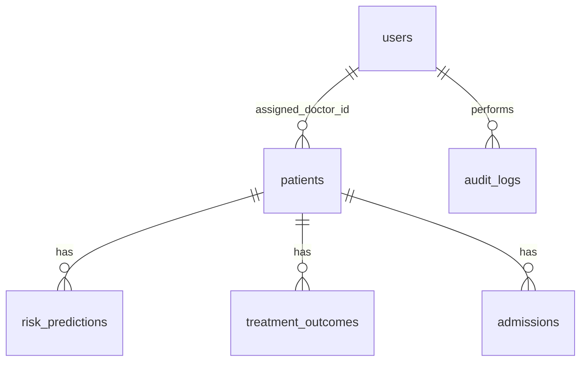

# Database design

The reference schema lives in
[`database/postgres/schema/01_schema.sql`](../../database/postgres/schema/01_schema.sql)
and the MongoDB collections in
[`database/mongodb/schemas/collections.md`](../../database/mongodb/schemas/collections.md).

## Deliverable for milestone 1

- An ER diagram covering `users`, `patients`, `admissions`, `risk_predictions`,
  `treatment_outcomes` and `audit_logs`.
- Which columns you indexed and why.
- How the Diabetes 130-US Hospitals columns map onto these tables.
- How a doctor's "assigned patients only" scope is enforced in a query.

## Notes that matter

- `patients` holds a de-identified medical record number. No names, addresses,
  phone numbers or exact dates of birth belong in this schema.
- `audit_logs` is append only. Never update or delete a row.
- Encounters where the patient died or entered hospice cannot be readmitted.
  Leaving them in the training set leaks the target - handle this explicitly.

---

## Project documentation (HealthForecast AI)

Reference schema: [`database/postgres/schema/01_schema.sql`](../../database/postgres/schema/01_schema.sql),
generated from the models by `backend/scripts/export_schema.py`.

### ER diagram



Tables: `users`, `patients`, `admissions`, `risk_predictions`, `treatment_outcomes`,
`audit_logs`. Check the column lists in `01_schema.sql` against the models; this file
does not repeat them so the two cannot drift.

### Indexes

| Column | Why |
|---|---|
| `users.email` (unique) | Login lookup |
| `patients.medical_record_number` (unique) | De-identified lookup key |
| `patients.assigned_doctor_id` | Doctor scope filter on every list |
| `risk_predictions.patient_id`, `created_at` | Latest-score-per-patient query |
| `treatment_outcomes.treatment_type`, `created_at` | Effectiveness and trend aggregates |
| `audit_logs.created_at` | Audit viewer |

[Confirm this list against `01_schema.sql` before submitting.]

### Diabetes 130-US Hospitals mapping

| Dataset column | Used as |
|---|---|
| `age` | `age_group` (ten-year buckets) |
| `gender` | `gender` (normalised to Male/Female) |
| `time_in_hospital` | `time_in_hospital` (1-14 days) |
| `number_inpatient`, `number_emergency`, `number_outpatient`, `number_diagnoses`, `num_medications` | Risk model inputs |
| `readmitted` | Target: `<30` = 1, otherwise 0 |
| `discharge_disposition_id` (expired, hospice) | Rows removed from training: those patients cannot be readmitted, keeping them leaks the target |

[Replace the model-input list with the exact seven fields from `schemas/prediction.py`.]

### Doctor scope in a query

```python
query = db.query(Patient)
if user.role == "doctor":
    query = query.filter(Patient.assigned_doctor_id == user.id)
```

This lives in `patient_service.get_visible_patients` and `risk_service`, so every
endpoint that lists patients applies the same rule.

### Rules followed

- `patients` holds a de-identified MRN only: no names, addresses, phones or exact dates of birth.
- `audit_logs` is append only.
- Seed data is synthetic (`scripts/seed_demo_data.py`).
- Local SQLite data was moved to Postgres with `scripts/migrate_sqlite_to_postgres.py`.

### Not implemented

MongoDB collections (`clinical_notes`, `model_runs`, `prediction_events`) are
documented in `database/mongodb/schemas/collections.md` but not built.