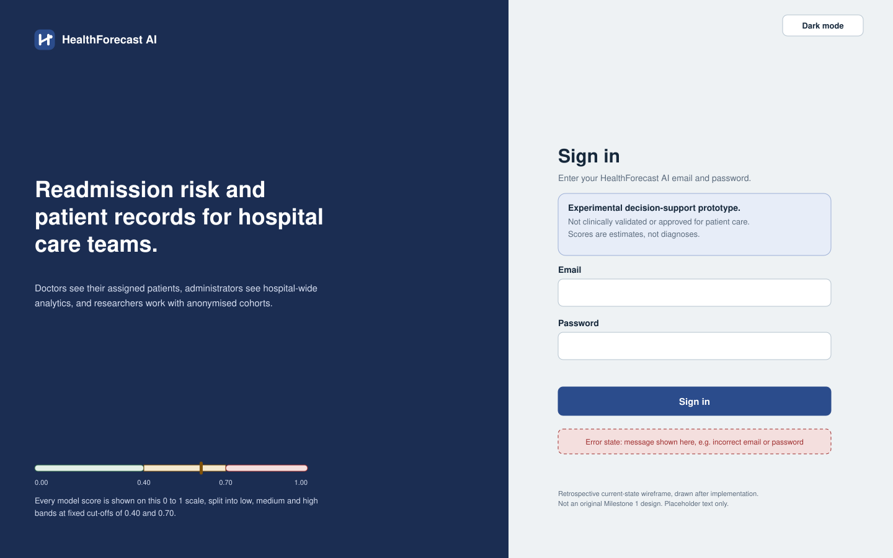
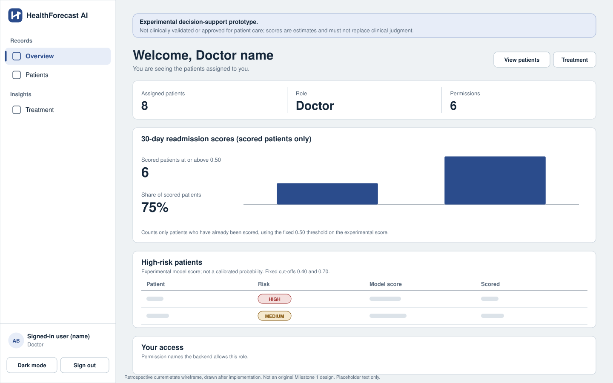
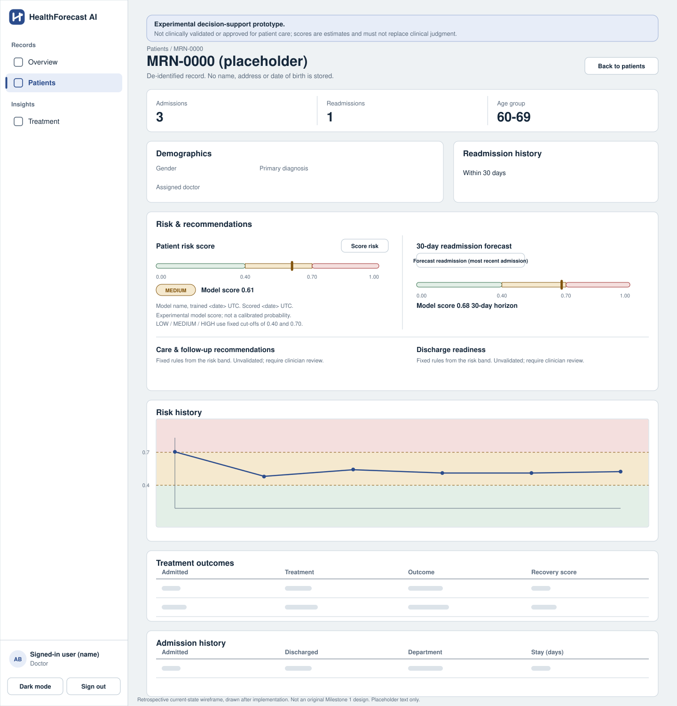
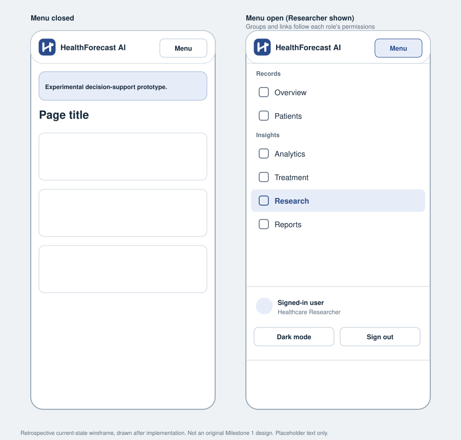
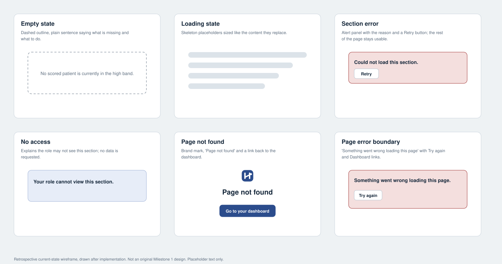

# Wireframes

> **Read this first.** These wireframes were drawn **after** the interface was
> built, from the pages and components in `frontend/src/`. They document the
> **current implemented screens**. They are **not** the original Milestone 1
> design wireframes, which were not produced at the time, and they are not
> browser screenshots. Every name, number and record shown is a placeholder.
> Redraw them if the interface changes.

Each file is a standalone SVG (under 20 KB, XML-validated, readable in any
browser or editor). The shell, the left sidebar and its groups match the
implemented navigation: **Records** (Overview, Patients), **Insights**
(Analytics, Treatment, Research, Reports) and **Administration** (Users). Each
role sees only the links its permissions allow (see
[`docs/04-rbac`](../04-rbac/README.md)).

## Index

| Screen | Role(s) | File |
|---|---|---|
| Login | Everyone | [current-login.svg](current-login.svg) |
| Overview (doctor): assigned patients, forecast, high-risk list | Doctor | [current-doctor-dashboard.svg](current-doctor-dashboard.svg) |
| Patient detail: demographics, risk and recommendations, risk history, outcomes, admissions | Doctor (also Hospital Administrator and System Administrator, read scope differs) | [current-doctor-patient-detail.svg](current-doctor-patient-detail.svg) |
| Treatment effectiveness | Doctor (own patients), Hospital Administrator, Researcher, System Administrator | [current-treatment.svg](current-treatment.svg) |
| Overview (hospital administrator): hospital-wide forecast, no high-risk list | Hospital Administrator | [current-hospital-admin-dashboard.svg](current-hospital-admin-dashboard.svg) |
| Analytics (readmissions tab shown; five tabs) | Hospital Administrator, Researcher, System Administrator | [current-hospital-admin-analytics.svg](current-hospital-admin-analytics.svg) |
| Reports: generate and history | Hospital Administrator, Researcher, System Administrator | [current-reports.svg](current-reports.svg) |
| Research analytics: filters, statistics, export, anonymised cohort | Researcher, System Administrator | [current-researcher-research.svg](current-researcher-research.svg) |
| Anonymised patient cohort (replaces the patient list) | Researcher | [current-researcher-patients.svg](current-researcher-patients.svg) |
| Overview (system administrator): every shortcut | System Administrator | [current-admin-dashboard.svg](current-admin-dashboard.svg) |
| Users | System Administrator | [current-admin-users.svg](current-admin-users.svg) |
| Responsive navigation at 390 px, closed and open | All | [current-mobile-navigation.svg](current-mobile-navigation.svg) |
| Empty, loading, error, no-access, not-found states | All | [current-states.svg](current-states.svg) |

## Previews

## Coverage against the original screen list

The earlier version of this file listed the screens each role was expected to
have. This is how they compare with what was built.

| Role | Expected screens | Status |
|---|---|---|
| Doctor | Assigned patient list, patient detail with risk score, care recommendations, discharge planning | Built: patient list (search), patient detail with the risk score, forecast, recommendations and discharge readiness. The list page itself is not drawn separately; it is a titled search form over a table. |
| Hospital Administrator | KPI dashboard, readmission analytics, department performance, exports | Built: overview, analytics (readmissions, outcomes, risk distribution, departments, population health) and reports. |
| Healthcare Researcher | Anonymised cohort browser, population health charts, dataset export | Built: anonymised cohort, research analytics and export, population health tab. |
| System Administrator | User management, model registry, audit log viewer | User management built. **No model registry page and no audit-log viewer exist** in the interface (the registry is available only through the read-only `/models` API; audit rows are not readable). |

## What the screens deliberately show

- The **experimental-status notice** sits above the content of every dashboard
  page and above the sign-in form.
- Every score is captioned as an experimental model score, not a calibrated
  probability, and the low, medium and high bands are shown with their fixed
  0.40 and 0.70 cut-offs. The risk band is always written as text as well as
  coloured.
- Researchers never see identifiers, and a cohort smaller than the minimum size
  is refused instead of shown.
- Empty, loading and error states are shown together in
  [current-states.svg](current-states.svg) because the pages share the same
  components for them.

## Rules

- A wireframe must show the empty state and the error state, not just the happy
  path. Shared states are in `current-states.svg`, and the login wireframe shows
  its inline error.
- Never use a real patient's data in a mockup. Use obviously synthetic text.
- Commit exports as PNG or SVG, under 1 MB (CI warns above that and blocks above
  5 MB). Link them from the milestone reports.
- Do not delete or overwrite a historical design. Keep new work next to it.
