# Milestone 4 report - Week 7 & 8 - Testing, Deployment & Documentation

- **Intern name:** Parimala M
- **Branch:** `intern/24-parimala-m`
- **Submitted on:** 2026-10-11

---

## Scope for this milestone

- Validate prediction accuracy and healthcare analytics quality.
- Optimize healthcare workflows and dashboard responsiveness.
- Deploy the platform using Docker and a cloud environment.
- Prepare the final project documentation and presentation.
- Demonstrate the complete HealthForecast AI platform.

## Evaluation criteria

- Fully deployed frontend and backend.
- Model testing and validation completed.
- Documentation and presentation prepared.
- Successful end-to-end platform demonstration completed.

---

## What I built

HealthForecast AI is a hospital readmission prediction and patient risk intelligence
platform with four roles (doctor, hospital administrator, researcher, system
administrator). This milestone finished testing, deployment and documentation.

### Frontend (Next.js, TypeScript, Tailwind, Recharts)

Login, dashboard overview, patient registry, risk prediction, high-risk patients,
readmission forecast, treatment effectiveness, healthcare analytics, research cohort,
clinical support, reports and exports, model management, and user management. The
sidebar shows only the pages the signed-in role is allowed to use. Pages have loading,
error and empty states.

### Backend (FastAPI, SQLAlchemy, PostgreSQL)

JWT login, permission-based access control on every protected endpoint, audit logging,
user and patient management, risk prediction, high-risk retrieval, readmission
forecast, treatment effectiveness with recovery trends, analytics, anonymised research
cohort, CSV reports, and model management endpoints.

### Machine learning

An XGBoost classifier trained on the Diabetes 130-US Hospitals dataset using the seven
fields a clinician can enter in the prediction form. Logistic regression, random forest
and XGBoost are trained; the best F1 among models that pass the promotion bar is
promoted. The decision threshold is chosen for the best F1 with recall at least 0.50.

### Deployment and CI

- Backend: Docker service on Render. Frontend: Docker service on Render.
- Database: Render PostgreSQL (moved from local SQLite).
- Fixes made while deploying: corrected the frontend Docker `PORT`/`HOSTNAME`,
  packaged the trained model into the backend image (see Known gaps for the artifact
  policy), replaced SQLite-only date functions with portable `cast(..., Date)`, and
  added a Postgres service to the CI backend job.
- CI checks: lint, format, type check, tests, frontend build, repository policies and
  milestone report structure.

### Documentation

Architecture, database, API, RBAC, wireframes, test plan and deployment runbook, all
under `docs/`. See the index in [`docs/README.md`](../README.md).

### Project evolution

Earlier reports describe earlier states. These changes were deliberate:

| Area | Earlier | Final | Why |
|---|---|---|---|
| Dataset | India dataset (Milestone 1) | Diabetes 130-US Hospitals | Named in the brief; matches the team's model code |
| Model inputs | 40+ engineered features | 7 form-collectable features | The UI cannot collect 40 fields; extra fields were padded with NaN |
| Database | SQLite | Render PostgreSQL | Deployment needs a hosted database |
| Recovery trend | One month bucket | Daily buckets | Demo data spans days, not months |

## How to run it

```bash
git clone https://github.com/GKSJ-AI-CliniScan/HealthForecastAI.git
cd HealthForecastAI
git checkout intern/24-parimala-m
```

Backend (`DATABASE_URL`, `SECRET_KEY`, `MODEL_ARTIFACT_DIR` come from `backend/.env`;
see [`docs/08-deployment`](../08-deployment/README.md) for the list):

```bash
cd backend
python -m venv venv && source venv/bin/activate      # Windows: venv\Scripts\activate
pip install -r requirements-dev.txt
python scripts/seed_admin.py
uvicorn app.main:app --reload                        # http://127.0.0.1:8000/docs
```

Frontend:

```bash
cd frontend
npm install
echo NEXT_PUBLIC_API_URL=http://127.0.0.1:8000/api/v1 > .env.local
npm run dev                                          # http://localhost:3000
```

Train the model (needs `diabetic_data.csv` in `ml/data/raw/`, not committed):

```bash
cd ml
pip install -r requirements.txt
python -m src.models.train --config configs/config.yaml
```

Tests:

```bash
cd backend && pytest --cov=app
```

## Evidence

Screenshots are in `docs/06-milestones/evidence/`. All data shown is synthetic.

| Workflow | Screenshot |
|---|---|
| Login | 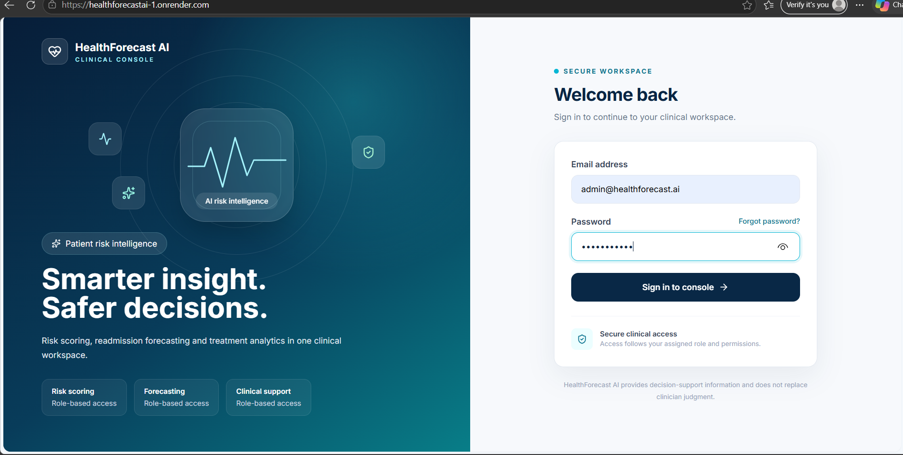 |
| Role-based access (doctor) | 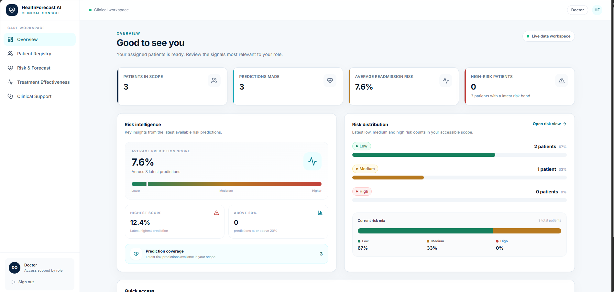 |
| Patient registry and management | 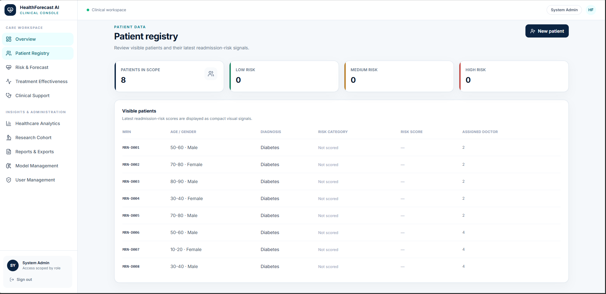 |
| Readmission risk prediction | 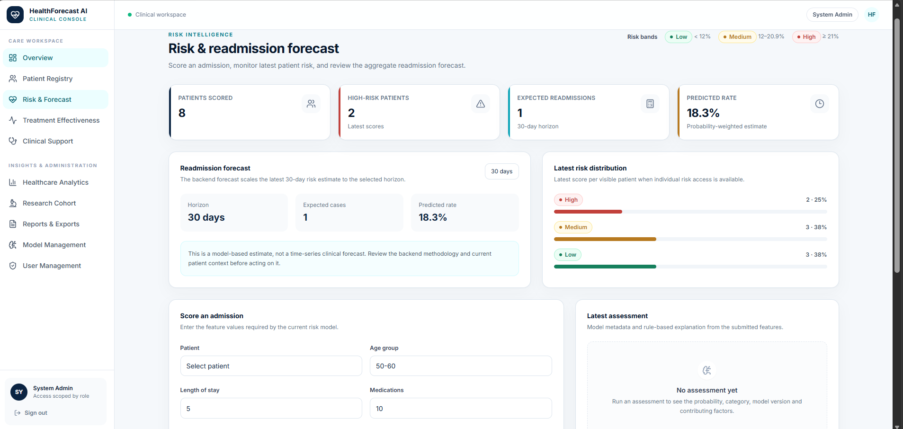 |
| High-risk patients and forecast | 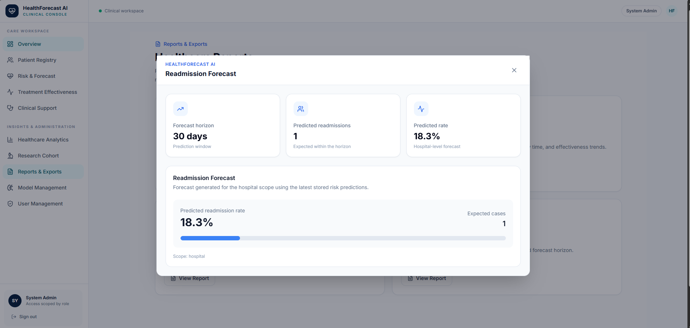 |
| Treatment effectiveness and recovery trend | 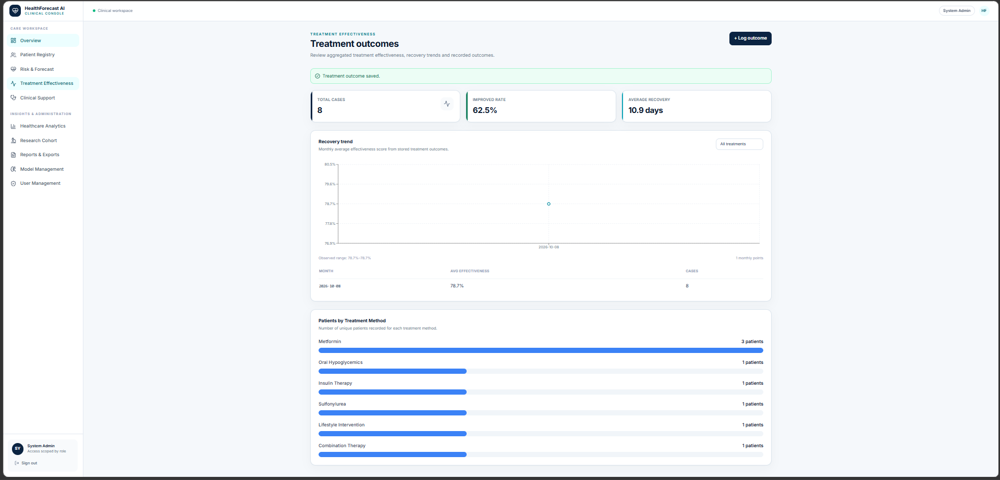 |
| Healthcare analytics | 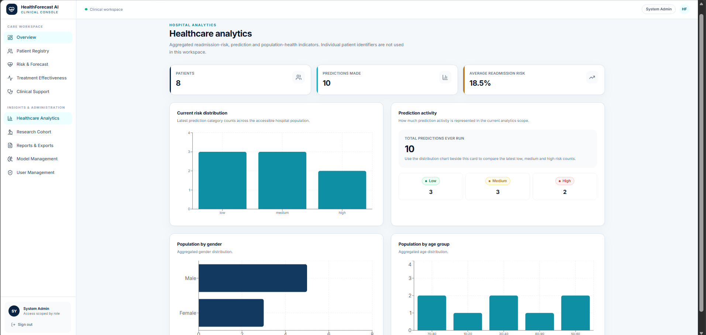 |
| Research cohort (anonymised) | 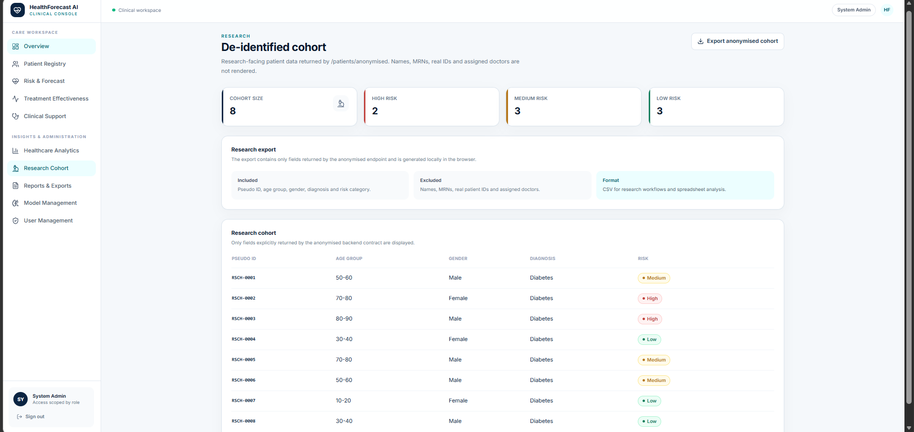 |
| Clinical support | 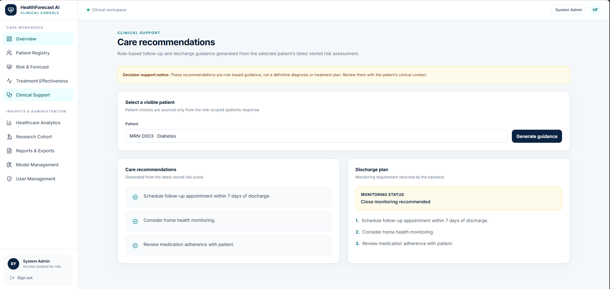 |
| Reports and exports | 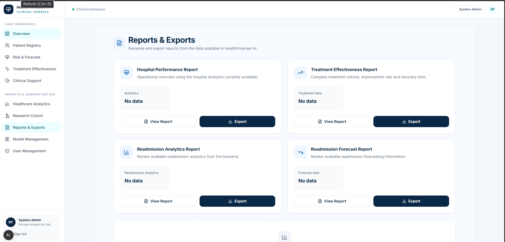 |
| Model management |  |
| User management | 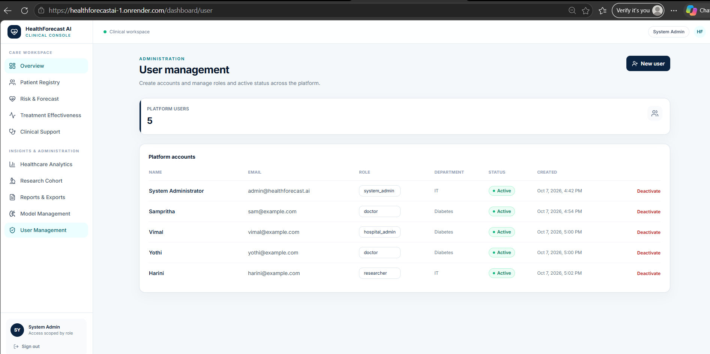 |
| Backend health check |  |
| CI passing |  |

## Metrics

### Model (final deployed model, held-out test set)

| Metric | Value |
|---|---|
| Model | XGBoost, 7 features |
| Decision threshold | [from threshold.joblib] |
| ROC-AUC | [from metrics.joblib] |
| Recall | [from metrics.joblib] |
| Precision | [from metrics.joblib] |
| F1 | [from metrics.joblib] |
| Accuracy | [from metrics.joblib] |

Accuracy is not the headline metric: the base readmission rate is about 11%, so a
model that always predicts "not readmitted" would score about 89% accuracy. ROC-AUC
and recall matter most. These are evaluation results on a public research dataset, not
clinical performance.

### Tests and CI

- Backend tests: [n] passing, coverage [x]% (`pytest --cov=app`).
- CI on the latest commit: [passing/failing], link: [run URL].
- Full test plan: [`docs/07-testing`](../07-testing/README.md).

### Deployment

| Component | Status |
|---|---|
| Frontend | Deployed |
| Backend | Deployed |
| Database | Render PostgreSQL, connected |
| Model | Loaded by the backend |
| Frontend to backend | [Verified on date, by logging in on the live URL] |

Live URLs:

- Frontend: <https://healthforecastai-1.onrender.com>
- Backend API base: <https://healthforecastai-sarj.onrender.com/api/v1>
- API docs: <https://healthforecastai-sarj.onrender.com/docs>

No response-time or load tests were run.

## Known gaps

- ROC-AUC is below the brief's 0.65 target if the final 7-feature model reports less
  than 0.65. The promotion bar was lowered to 0.60 for this reason.
- MongoDB (clinical notes, model registry, prediction events) was in the brief but is
  not implemented. The model registry reads artifacts from disk.
- The forecast scales the current probability by horizon length. It is not a
  time-series model.
- Reports export as CSV only.
- No automated frontend tests.
- The model file is committed with `git add -f` into `backend/model_artifacts/` so the
  Docker image can load it. This is an exception to the artifact policy and needs
  mentor approval.
- Render free tier sleeps when idle, so the first request can take about a minute.
- Needs external validation, monitoring and explainability before any clinical use.